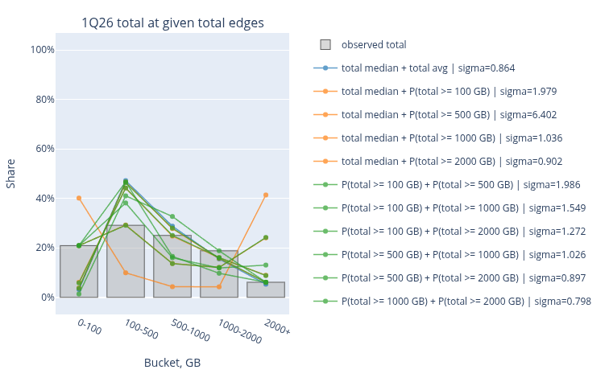
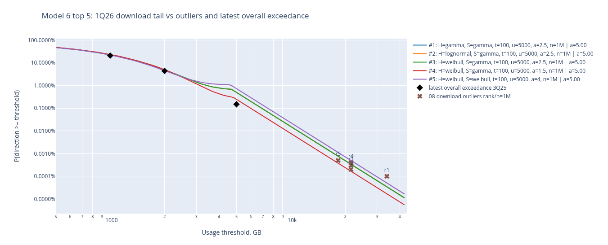
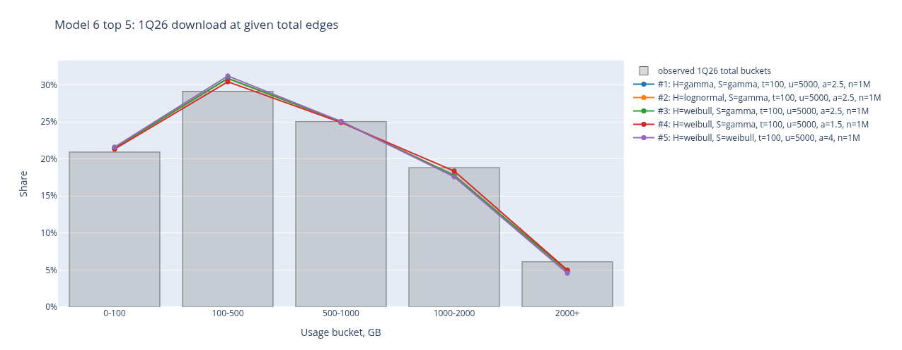
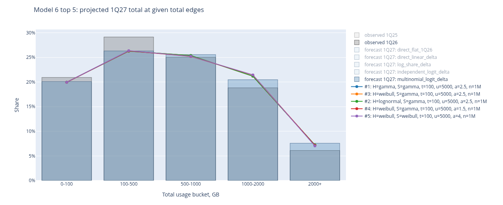

# Evaluating a monthly bandwidth-usage model

*Engineering deep dive · approximately 8–10 minutes*

The reporting system compares monthly vnStat measurements with a modeled distribution of household broadband usage. Its central question is: **what share of the reference population would use at least this much data in a month?** This analysis turns published summary statistics into a continuous survival curve, tests that curve against the summaries, and identifies where the answer becomes speculative. The deployment and report-generation pipeline belong in the separate project case study.

## Evidence and reconstruction

I transcribed mean total, download, and upload usage; total medians; exclusive usage buckets; published exceedance thresholds; and a short list of ranked outliers from nine OpenVault Broadband Insights reports spanning 1Q24–1Q26. Units are decimal GB of monthly usage. The analysis used Jupyter Notebook 7.5.6, pandas 2.3.3, NumPy, SciPy, and Plotly.

The principal fit uses **DOCSIS total-usage buckets** for 1Q25 and 1Q26: 0–100, 100–500, 500–1,000, 1,000–2,000, and 2,000+ GB. I normalized the transcribed shares to sum to one, then compared the resulting distribution with published *overall* means and medians. That is an imperfect population match: the bucket table describes DOCSIS while the summary statistics describe all access types. It is a source of model error, not a difference that fitting can remove. A separate exceedance table contains overall rates at selected thresholds and dates; ranked outliers are reported for download and upload, not total usage.

The open 2,000+ GB bucket contains no information about how its members are distributed. Means partly constrain its contribution, while outliers and other exceedance observations provide only sparse checks. Treating a bucket midpoint as the usage of everyone in that bucket would make the mean look simpler than the data warrant.

## Why a single lognormal failed

A lognormal was a reasonable first baseline: monthly usage is positive and right-skewed, and the mean and median determine its parameters directly. With median $m$ and mean $bar x$,

$$
\mu=\log m
$$

and

$$
\sigma=\sqrt{2\log(\bar x/m)}
$$

A modeled mean that exactly matches the published mean under this fit is therefore **true by construction**; the bucket shares are the actual test.

For 1Q26, that fit predicted **3.2%** below 100 GB and **47.2%** in 100–500 GB. The observed DOCSIS shares were **20.9%** and **29.1%**. The published median was 496 GB, close to the 500 GB boundary, yet the fitted lognormal placed far too little of the lower half below 100 GB. Alternative lognormal fits using a median and one threshold or two thresholds moved the error around rather than resolving this shape mismatch. Some bucket-only solutions produced implausible means or medians.

I next tested a single Weibull distribution using the same summary constraints and several threshold-based estimators. It reduced bucket error materially, but fitting a point close to the published median could be unstable: the 1Q26 median-plus-500 GB candidate implied an absurdly large mean. A good candidate must be checked against **all buckets and the mean**, not just the two points that determine its parameters.

| Single-family fit constrained by mean and median | 1Q25 bucket RMSE | 1Q26 bucket RMSE |
| --- | ---: | ---: |
| Lognormal | 11.3 percentage points | 11.5 percentage points |
| Weibull | 4.1 percentage points | 5.0 percentage points |

<figure>
  

  <figcaption>
    Figure 1: 1Q26 observed-versus-fitted bucket comparison.
  </figcaption>
</figure>

## Testing the far tail

An exploratory tail calculation started at **2,000 GB**, where the observed terminal bucket gives $S(2{,}000)$: about **4.88%** for 1Q25 DOCSIS and **6.11%** for 1Q26 DOCSIS. A 4Q24 overall exceedance observation gave **6.0%** at the same threshold. For a pure Pareto continuation above an anchor $u$, the assumed survival is

$$
S(x)=S(u)(u/x)^\alpha,\qquad x\ge u.
$$

The exploratory total-usage scenarios used exponents 3.5, 4.5, and 5.5 and effective-population scenarios of 1, 3, and 10 million. I compared implied threshold counts with five published 4Q24 download outliers, using download as a **proxy** for extreme total usage because there were no ranked total outliers. Upload had a separate rank-based calculation. An effective population converts $p$ into an expected rank $n_{\mathrm{eff}}p$; it is not an observed sample size in this dataset. This exercise showed how rapidly a plausible-looking terminal bucket can diverge at 10–34 TB as the exponent changes. It did not establish a unique tail law.

The final segmented model places its Pareto boundary at **5,000 GB**, with exponent **2.5**. This is a different construction from the exploratory 2 TB anchor. Conditional on already exceeding 5 TB, the final tail says $P(X\ge10\,\mathrm{TB}\mid X\ge5\,\mathrm{TB})=2^{-2.5}$, or about **18%**. Exponents of 1.5 and 4 would give approximately **35%** and **6%**. The threshold, exponent, and thin outlier evidence therefore dominate very rare estimates.

<figure>
  

  <figcaption>
    Figure 2: Tail-sensitivity / observed-versus-modeled exceedance plot.
  </figcaption>
</figure>

## The segmented-model search

The next model used a truncated distribution for the low-usage **head**, another for the **shoulder**, and a pure Pareto tail. Each of the first two segments could be gamma, Weibull, or lognormal. I searched head boundaries at 100, 500, and 1,000 GB; tail boundaries at 1,000, 2,000, and 5,000 GB; and seven Pareto exponents from 1.2 to 4.0. Invalid boundary pairs were excluded. The surviving grid had **504 configurations**; fitting both observed periods yielded **1,008 period-level models in about 153 seconds** in the recorded run.

For each period, SciPy least squares adjusted the component parameters and segment masses. Residuals included the five bucket shares and relative mean and median errors, each scaled by a 2.5-percentage-point target; a tail contribution exceeding the published mean incurred a penalty. The segments were truncated to their respective intervals. Their masses joined to form a continuous, monotone survival function with nonnegative bucket shares. Exponents of one or below were excluded because their pure Pareto tails have infinite means.

Ranking used a two-way period check: fit 1Q25 and evaluate 1Q26, then fit 1Q26 and evaluate 1Q25. **Before each held-out check, I scaled the model to the held-out median.** This tests whether the shape transfers after a known scale adjustment, not whether the model predicts an unseen median. Acceptable candidates had fits for both periods, small in-sample mean/median errors, and a plausible tail contribution. Bucket RMSE led the ranking; recent overall exceedance rates and outlier ranks were softer diagnostics.

| Selected configuration | Cross-period result |
| --- | ---: |
| Head / shoulder | gamma / gamma |
| Boundaries | 100 / 5,000 GB |
| Pareto exponent | 2.5 |
| Mean bucket-share absolute error | 0.456 percentage points |
| Bucket-share RMSE | 0.545 percentage points |
| Worst single-bucket miss | 1.054 percentage points |
| Mean-usage absolute error | 3.191% |

The first two rows of the earlier table are **single-family fits to 1Q25 or 1Q26**; these figures summarize **median-scaled cross-period checks**. They are useful evidence for the segmented shape, but not a common blind-test leaderboard. The runner also selected an effective population of one million for its outlier-rank diagnostic. That setting should not be read as an independently measured OpenVault population size.

<figure>
  

  <figcaption>
    Figure 3: 1Q26 observed-versus-segmented-model bucket plot.
  </figcaption>
</figure>

## Checks beyond the fitted buckets

The selected model reproduced the held-out buckets after median scaling, with a maximum miss of about **1.05 percentage points**. It reproduced the held-out mean less closely, at **3.19%** average absolute relative error. These checks are informative for the body of the usage distribution.

The tail check was much weaker. Against separately published *overall* exceedance observations from other periods, the selected candidate had **67.37% mean absolute relative error**, with a **289.69% maximum**, largely driven by the 5 TB observation. These are different dates and access populations, so the comparison is not a pure holdout. Still, the disagreement is too large to present the far tail as validated. The initial total-model outlier diagnostic also predicted upload ranks very poorly; that failure motivated a separate directional projection rather than carrying the total tail unchanged into upload.

## A 1Q27 scenario, not a measured outcome

For a future reporting period I extrapolated the available 1Q24–1Q26 mean and median series, comparing linear and log-linear trends with a small rolling backtest. Selected 1Q27 inputs were **802.36 GB** total mean, **561.93 GB** total median, **738.18 GB** download mean, and **66.86 GB** upload mean. The directional means sum to **805.04 GB**, about **0.33%** above the separately projected total mean; they were not forced to agree exactly.

Only **two** same-quarter DOCSIS bucket distributions, 1Q25 and 1Q26, were available for projecting 1Q27 shares. I compared persistence, direct change, log-share change, and logit-based change, then used a multinomial/logit change that preserves a valid sum of shares. It projects **20.08%, 26.31%, 25.56%, 20.47%, and 7.58%** across the five buckets, respectively. Refitting the five saved finalist structures to those *projected* inputs kept gamma/gamma first, with **0.372 percentage points** bucket RMSE against the projection. That number is an internal consistency check, **not a forecast error against observed 2027 usage**.

<figure>
  

  <figcaption>
    Figure 4: [Forecast] 1Q27 projected bucket shares and selected model curve.
  </figcaption>
</figure>

## Download and upload projections

No matching direction-specific bucket distributions were available. I therefore reused the finalist total-usage shapes, constrained each projected direction to its published or forecast mean, and estimated a directional median by scaling the total median by the direction-to-total mean ratio. I searched directional Pareto exponents and effective-population assumptions against the five ranked download or upload outliers. For the selected production scorer, the exponents are **5.0 for download** and **4.0 for upload**, versus **2.5 for total**.

This procedure makes the directional means match by construction. It cannot validate the directional bucket shapes or the estimated medians. The rank evidence comes from 4Q24, while the shapes are projected for 1Q25, 1Q26, and 1Q27. The directional curves are best treated as rough context for live download/upload measurements, especially at extreme thresholds.

## Interpretation and threats to validity

For observed monthly usage $x$, the scorer returns an estimated $S(x)=P(X\ge x)$ and its reciprocal, reported as **1 in N**. If $S(x)=0.01$, the interpretation is approximately one in 100 households in the *modeled reference distribution* reaching at least $x$ in a month. It does not mean this household has a 1% chance of repeating that amount next month, and it is not a capacity or billing forecast.

- **Aggregated observations.** Five wide buckets and a few summary statistics leave many continuous shapes observationally equivalent, especially inside the open 2,000+ GB bucket. The chosen segment boundaries and tail exponent are model assumptions.
- **Population mismatch.** DOCSIS buckets were fitted alongside overall means/medians and compared with overall exceedance observations. Access mix, geography, publisher methodology, and dates may differ. A close match can partly reflect compensating errors.
- **Selection on two periods.** Cross-period evaluation used only 1Q25 and 1Q26. The held-out median supplied the validation scale, and the same two periods guided model selection among 504 configurations. The 0.545-point RMSE is therefore an internal model-selection result, not independent external validation or a confidence interval.
- **Tail identifiability.** The final 5 TB boundary has limited direct same-period support. Ranked outliers are sparse and direction-specific; download was used as a proxy for extreme total usage in the exploratory step. Extreme probabilities can change greatly with the threshold, exponent, and assumed effective population. The published 5 TB exceedance disagreement remains unresolved.
- **Forecast uncertainty.** The 1Q27 metric trends have short history, and the bucket trend has only two same-quarter points. A fit to projected shares merely confirms the model can reproduce those projected inputs. Directional distributions inherit additional scale and rank assumptions without directional bucket validation.

The strongest result is the reconstruction of the **observed middle and bucket-level distribution**. Rare-event incidence and future directional scores are model-conditioned estimates. Reports should display them as comparative context, with the tail caveat visible wherever a very large “1 in N” value appears.

## Related Resources

  <a href="/projects/bandwidth-usage-modeling-and-reporting"  class="btn-primary">
    Read Project Case Study
  </a>
  <a
    href="https://github.com/ari-t-foster/projects/bandwidth-usage-modeling-and-reporting"
    class="btn-secondary"
    target="_blank"
    rel="noopener noreferrer"
  >
    GitHub Repository
  </a>

