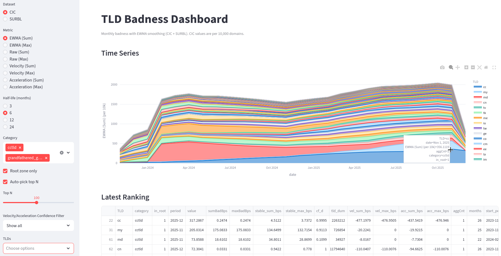
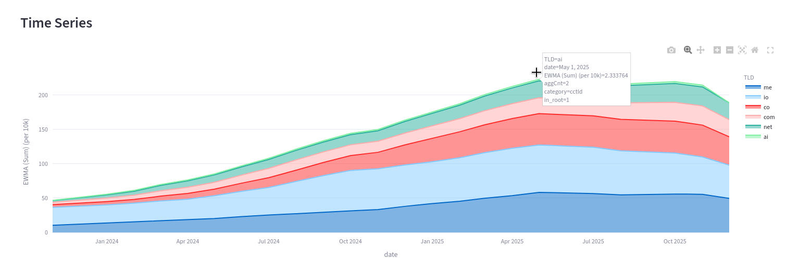
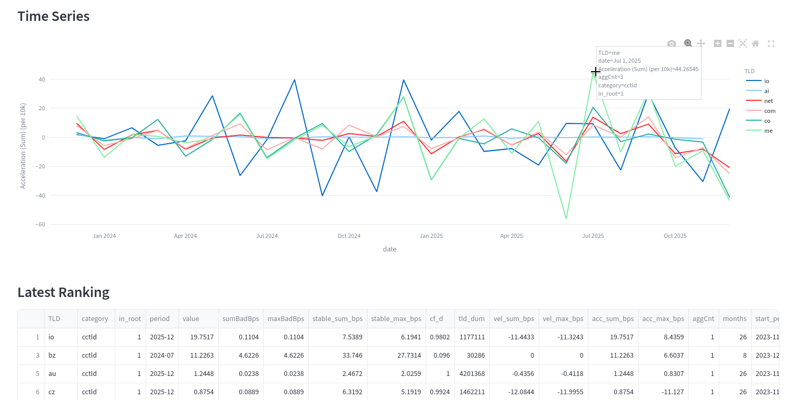

# TLD Reputation Analysis

## Abstract

I built a SQLite and Streamlit dashboard to compare top-level domains before choosing a long-term home for personal email and hosted services. The question was practical: **could an affordable domain inherit a poor reputation from its surrounding TLD?** Public datasets reported abuse in different categories, windows, and units, while registration counts and prices arrived from still other sources. I wrote collectors and SQL transforms to make those inputs comparable, then exposed per-10,000-domain rates, time trends, category bounds, prices, and TLD filters in an interactive dashboard. The work informed a conservative choice of `.com` and `.net`. The dashboard is a decision aid, not a measured probability that a particular new domain will be blocked or distrusted.

## The decision and the data problem

A domain used for a résumé, portfolio, professional email, or personal services needs to remain usable for years. A low first-year registration price is not much of a bargain if renewal is expensive or the TLD's reputation becomes a persistent nuisance. I wanted to compare *neighborhood-level association risk* while keeping cost and registry characteristics visible. I was not trying to predict which TLD would attract the most new abuse next week.

The simplest starting rate is abusive domains observed in a period divided by domains under management (DUM), multiplied by 10,000. A raw count penalizes a large TLD merely for being large; a rate puts different populations on a common scale. Smoothing that rate over time can distinguish a persistent pattern from a short-lived spike. But the numerator is not a clean census: the Cybercrime Information Center (CIC) category tables cover multi-month windows, SURBL's archive is a monthly *top-40* list with a different collection bias, and counts across categories cannot be deduplicated from aggregate tables. The denominator also arrives at particular release dates, rather than for every synthetic month in the analysis.

I treated the output as a **comparison of observed signals**, with source, window, and missingness in view. The intended choice also involved registration and renewal prices, familiarity of the TLD, and the needs of a professional identity. Those factors did not collapse into one mathematically defensible score.

## Four stages of the work

| Stage | Role in the final result |
| --- | --- |
| Part 1: acquisition and merging | Parse category CSVs and SURBL's archived monthly rankings into consistent input files. |
| Part 2: SQL exploration | Test time-window splitting and DUM alignment in a SQLite Browser project. |
| **Part 3: dashboard** | Rebuild derived SQLite tables and present rankings, trends, filters, and price context in Streamlit. |
| Part 4: daily collection | Collect fresh SURBL rankings and `.com`/`.net` domain-base figures for possible future ingestion. |

Part 3 is the completed user-facing artifact. Part 4 produces additional dated extracts; the supplied code does not show those extracts entering the Part 3 rebuild or a scheduler definition for unattended operation.

## Cleaning sources into comparable records

The first CIC collector reads category-specific CSV files, takes the TLD, DUM, and observed-domain count columns, and derives the category and start/end dates from filenames. It writes a common `TLD, TLD DUM, badnessCategory, badDomains, startMonth, startYear, endMonth, endYear` shape. That resolves column-name and reporting-window differences such as “Spam Domains” versus “Total Malware Domains.” A separate SURBL collector caches archived reports for 2024–2025, parses monthly top-40 TLD/count rows, and aggregates them into a second CSV. The archive is useful for a distinct trend view; it is not interchangeable with CIC's windowed, category-specific counts.

SQLite then performs the hard reconciliation. CIC observations cover intervals rather than individual months. A recursive query expands each interval and **allocates its integer count evenly** across its months, distributing any remainder over the first months so that the pieces sum to the published total. This preserves the interval count while creating a monthly series for plotting and smoothing. It does *not* reveal which month each observed domain actually appeared. A DUM release table groups denominator observations by their assumed start month; each derived month takes the most recent available release at or before it. That is a carry-forward assumption, not a measured monthly domain population.

The rebuild also creates a TLD category table by joining observed names with root-zone, country-code, and registry-agreement lists. It marks whether a name appears in the root and classifies it as a country-code, new, or grandfathered generic TLD. A price preparer parses registration, renewal, transfer, and selected multi-provider values while retaining currency symbols in separate fields. The dashboard shows these fields as context; it does not silently compare unlike currencies or assert that a quoted price is still available.

The resulting database has raw input tables, interval-expanded CIC rows, carried-forward DUM observations, per-month CIC and SURBL series, categories, and prices. The `rebuild.sh` sequence generates category and price CSVs, recreates `db/tld.db`, imports source CSVs, and runs the metric-building SQL. Source data were omitted from the supplied archive, so the database and published rankings cannot be independently regenerated from this attachment alone.

## Rates, smoothing, and what each view means

For each TLD and derived CIC month, the SQL calculates two category aggregates: the **sum** of reported abusive-domain counts and the **maximum** single-category count. Each is divided by carried-forward DUM and multiplied by 10,000. If category sets overlap, the sum can count the same domain more than once; the maximum discards other categories. They are useful comparison views, not a deduplicated total. With staggered windows spread into synthetic months, even a strict same-month union bound requires more assumptions than the labels alone convey.

The dashboard also offers exponentially weighted moving averages with **3, 6, 12, and 24-month half-lives**. With monthly observation $r_t$, the calculation uses

$$
\begin{aligned}
E_t &= \alpha r_t + (1-\alpha)E_{t-1}, \\[6pt]
\alpha &= 1 - 2^{-1/h},
\end{aligned}
$$

where $h$ is the half-life in months.

A shorter half-life responds faster; the default six-month CIC sum view emphasizes more persistent differences. The SQL computes a separate shrinkage-style `stable_*` rate using a pooled reference and a 300,000-domain denominator weight, plus a size-based `cf_d` indicator. These appear as ranking columns, but the selectable EWMA curves are built from the **raw per-10,000 rates**, not from those stabilized rates.

“Velocity” in this implementation is the **month-to-month difference in the normalized observed rate**, and “acceleration” is its second difference. Neither is abusive *new registrations divided by all new registrations*. The dashboard can filter low-`cf_d` entries when inspecting these change metrics, helping prevent a tiny TLD's noisy difference from dominating the view. The values still inherit the source-window allocation and denominator assumptions.

SURBL has its own raw, EWMA, velocity, and acceleration series. Its archived input contains only ranked entries. The SQL fills months between a TLD's first and last appearance with zero when it has no row. In a top-40 source, **absence means “not reported in the top 40,” not verified zero abuse**. A sharp drop or trend derived from those filled months must be read with that censoring in mind. CIC and SURBL should remain separate evidence streams; adding their counts would mix populations and observation rules.

<figure>
  

  <figcaption>
    Screenshot 1: dashboard overview with dataset and metric controls visible. 
  </figcaption>
</figure>

<figure>
  

  <figcaption>
    Screenshot 2: CIC time series comparing a few candidate TLDs, with half-life shown.
  </figcaption>
</figure>

## The finished dashboard

The Streamlit app reads the derived SQLite database and uses Plotly for interactive time series. Its sidebar switches between CIC and SURBL, raw and smoothed metrics, sum and maximum CIC views, and the four half-lives. Users can filter by root-zone presence and TLD category, choose specific TLDs, or automatically select the top N for the current metric. The latest-ranking table exposes the selected value alongside source counts, DUM, date coverage, change metrics, category, confidence indicator, and available price fields. A visible date range matters: each TLD's “latest” row is its own most recent record, which may not be the same calendar month as another TLD's.

This made the exploratory SQL useful for an actual domain decision. I could compare trends instead of trusting a single alarming monthly count, notice when a tiny denominator exaggerated a rate, and review renewal cost beside reputation signals. The outcome was to use `.com` and `.net` for the long-term presence. That was a judgment across reputation, cost, and familiarity, **not** a claim that the dashboard proved either TLD risk-free or identified a universal numerical cutoff.

<figure>
  

  <figcaption>
    Screenshot 3: latest ranking with coverage dates, DUM, and price columns.
  </figcaption>
</figure>

## Current boundary and threats to validity

- **Association is not individual fate.** A TLD-level rate does not estimate whether a specific legitimate domain will be blocked, classified as spam, or trusted by a recipient. Domain history, sender configuration, content, and the recipient's own controls matter.
- **Source definitions differ.** CIC windows and categories and SURBL monthly top-40 observations have different collection rules. CIC category sums are not cross-category unique-domain counts; SURBL missing entries are censored. No merged “single badness score” is shipped.
- **Monthly precision is constructed.** Splitting a multi-month count evenly and carrying DUM forward makes a tractable series, but does not reconstruct observed monthly incidents or a contemporaneous denominator. EWMA smooths those derived inputs; it cannot recover missing timing.
- **Small populations and coverage.** A few observed domains can move a small TLD's per-10,000 rate dramatically. The separate stabilized columns and `cf_d` indicator help inspect this, while the default EWMA remains based on raw rates. Ranking rows may also have different latest dates and lengths of history.
- **Price and metadata snapshots.** Prices, currency, root status, and registry classifications come from imported snapshots. They need refreshed inputs before a purchase; a displayed rate is not a current quote.
- **Input quality.** The CIC merger coerces nonnumeric count values to zero. A future refresh should reject or log malformed rows explicitly, since a silent zero could make a TLD appear cleaner than the source supports.
- **Part 4 is upstream work.** Dated `.com`/`.net` domain-base and current SURBL extracts could improve later comparisons, but are not demonstrated as integrated daily dashboard updates in the supplied pipeline.

The engineering value of the project is the explicit reconciliation: preserve source identity, make the monthly and denominator assumptions inspectable, and keep several decision-relevant views available instead of hiding conflicting evidence inside one authoritative-looking number. The dashboard answered the practical domain-selection question well enough for my own decision while keeping the limits of the underlying measurements visible.

## Related Resources

  <a href="/projects/tld-reputation-analysis" class="btn-primary">
    Read Project Case Study
  </a>
  <a
    href="https://github.com/ari-t-foster/tld-reputation-analysis"
    class="btn-secondary"
    target="_blank"
    rel="noopener noreferrer"
  >
    GitHub Repository
  </a>

